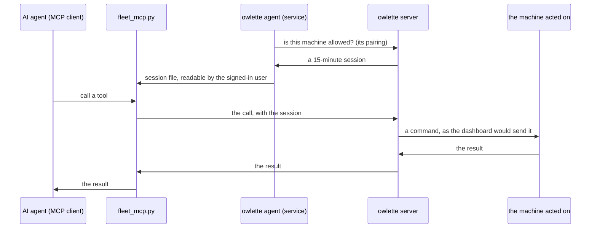

an AI agent on a paired machine (Claude Code, or any client that speaks [MCP](https://modelcontextprotocol.io)) connects to the owlette agent installed beside it and gets tools that act on other machines in the same site: read a machine's state, restart a process, change a setting, hand [hoot](/docs/dashboard/hoot) a task.

nothing new is installed and nothing is signed in. the machine was paired to its site when owlette was installed, and that pairing is what the server trusts. what the machine may do with it is yours to say, per machine, in the admin panel. it is **off until you turn it on**.

<Callout type="info" title="where it runs">
the machine the AI agent runs on must be on Windows, on owlette 4.2.0 or later. the machines it acts on can be on any platform owlette supports. macOS and Linux machines as the acting side come in a later release.
</Callout>

---

## turn it on

you need to own the site or be one of its admins, with the whole site in reach. the site's plan must include hoot.

1. open the **admin panel** and choose **settings** under **hoot** in the sidebar. with more than one site, pick the site at the top.
2. turn on **let machines act on other machines**.
3. under **machines that act on others**, turn on the machine the AI agent runs on. it starts out able to read and reaching no machine.
4. set **how far** it may go and **on which machines**.

every change saves as you make it and takes effect within seconds. the agent on a machine you just turned on picks its permission up on its own; nothing is restarted.

### how far

the three steps are hoot's [tool tiers](/docs/reference/hoot-tools#tier-system):

| setting | tier | what the machine may do |
|---|---|---|
| **read** | 1 | read state: system information, processes, logs, screenshots |
| **bounded changes** | 2 | tier 1, plus changes with validated parameters: start, stop and restart a process, edit the processes owlette manages, hand hoot a task |
| **privileged** | 3 | tier 2, plus shell commands, scripts, files, reboot and shutdown |

<Callout type="warning" title="privileged has nobody approving">
in the dashboard, hoot stops before a tier 3 tool and waits for you to approve it. a machine acting on its own has nobody to ask, so a machine set to **privileged** runs those tools at once. give it to a machine only if you would let whoever uses that machine run a shell on the machines it reaches.
</Callout>

### on which machines

| setting | reach |
|---|---|
| **no machines** | nothing. this is where a machine starts |
| **chosen machines** | only the machines you pick |
| **the whole site** | every machine in the site, including ones added later |

a machine may be one of its own chosen machines.

a machine never overrides [active hours](/docs/agent/remote-commands): an override needs a person to approve it, and a restart sent during active hours is held or refused as the machine's own settings say.

### who can use it

anything the signed-in user of that machine runs can use what you gave the machine. the permission belongs to the machine, not to one program on it. set it with that in mind on a machine other people sit at.

---

## connect an AI agent

the MCP server is a script that ships with the owlette agent. it talks to the client over stdio and is started by the client, so there is no port and no service to run.

### Claude Code

on the machine, in a terminal:

```powershell
claude mcp add hoot -- "C:\ProgramData\Owlette\python\python.exe" "C:\ProgramData\Owlette\agent\src\fleet_mcp.py"
```

then ask Claude to run `fleet_status`. it answers with the site, the machine and when its session expires, or says why it has none.

### any other MCP client

register a stdio server with this command and these arguments:

| | |
|---|---|
| command | `C:\ProgramData\Owlette\python\python.exe` |
| arguments | `C:\ProgramData\Owlette\agent\src\fleet_mcp.py` |

it needs no environment variables and no key.

---

## the tools

the list comes from the server each time the client asks, cut to what the machine may do, so it changes when you change the machine's settings and grows with owlette releases, without anything to update on the machine.

| tool | tier | what it does |
|---|---|---|
| `fleet_status` | none | answered on the machine itself: whether it may act, as which machine, on which site, and until when |
| `list_machines` | 1 | the machines it may act on: id, online or not, seconds since the last heartbeat, OS, agent version, whether hoot is on |
| `get_site_logs` | 1 | the site's activity log, for the machines it may act on |
| hoot's machine tools | 1 to 3 | every tool in the [hoot tools reference](/docs/reference/hoot-tools) that runs on a machine, each with one more parameter, `machine`, naming the machine to act on |
| `update_process`, `add_process`, `delete_process` | 2 | edit the processes owlette manages on a machine. these change its configuration and work while the machine is offline |
| `ask_hoot` | 2 | hand hoot a task in words and get its written answer back |

a tool that acts on a machine takes that machine's id as `machine`, from `list_machines`. one call acts on one machine.

a tool that waits on a machine runs for as long as the tool needs, up to 55 minutes; the client waits for it.

### handing hoot a task

`ask_hoot` takes a `prompt`, and optionally `machines`, a list of machine ids. without the list it works on every machine the calling machine may act on. hoot then works through the task with its own tools and writes an answer, which is what the tool returns.

- **whose key pays.** the task runs on the site owner's LLM key, the one in the owner's [account settings](/docs/dashboard/hoot#your-key). if the owner has saved none, the tool says so.
- **how far it goes.** tier 2 at most, even for a machine set to privileged: nobody is there to approve a tier 3 tool. it never creates a talon or schedules a follow-up, and it acts only on machines the calling machine may act on.
- **how many.** a machine may start six tasks an hour and run one at a time.
- **how long.** the client waits about ten minutes. a task that runs longer keeps running, its answer is not returned, and the machine's next task waits for it.
- **where it shows.** each task is a chat in the site owner's hoot conversations, titled `task from <machine>`, with every step hoot took. nobody else sees it.

---

## what is refused

a refused call answers with a reason the AI agent can read. the common ones:

| the tool says | why |
|---|---|
| `fleet_not_granted` | the site's switch is off, or this machine is not turned on under **machines that act on others** |
| `tool_not_allowed` | the tool is above what the machine is set to, or is not one a machine may call |
| `machine_not_granted` | the machine named is not one this machine may act on |
| `hoot_disabled` | hoot is turned off on the machine named. that switch stops machines as it stops people |
| `machine_offline` | the machine named is not online, and the tool needs its agent to answer |
| `plan_required` | the site's plan does not include hoot |
| `hoot_unavailable` | `ask_hoot` has no LLM key to run on |
| `rate_limited` | too many calls: 60 commands a minute per machine, or the task limits above |

turning a machine off under **machines that act on others**, or turning the site's switch off, ends what it can do within seconds, a session in use included. removing a machine from the site or pairing a new machine under its name clears its settings, so a reused name never inherits them.

---

## what the audit log shows

every call a machine makes is in the site's [audit log](/docs/cli/reference/audit-log) under the machine, as `machine:<machine id>`: an entry when the call is allowed, naming the tool and the machine it acts on, or an entry with the reason when it is refused. a command it queues, and a process it adds, changes or removes, carries the same name.

reads that only look something up (the tool list, checking on a call that is still running) write no entry.

a tool hoot runs on a machine while working on a task is recorded as any hoot tool is in a chat, in the task's conversation.

---

## how it works



- the service asks the server for a **fleet session** with the machine's pairing, and renews it every ten minutes while the machine is allowed. the session lasts 15 minutes and works on these calls only: it cannot do anything else the agent can.
- the service keeps the session in `C:\ProgramData\Owlette\ipc\fleet\session.json`, which the signed-in user can read and cannot change. the script reads it for each call and never sees the agent's own tokens.
- when the machine is turned off in the admin panel, unpaired or shut down, the service deletes the file.
- a command reaches the other machine the way one sent from the dashboard does, so everything on the [remote commands](/docs/agent/remote-commands) page holds for it.

---

## troubleshooting

**the client lists only `fleet_status`.** the machine has no session. run `fleet_status`: it says whether the machine is not turned on, the site's switch is off, or the server refused it. after you turn a machine on, its agent asks for a session within a minute if the machine is online; one that was offline asks within the hour, or as soon as its owlette service starts.

**a tool that was there is gone.** the machine's **how far** setting was lowered, or the tool needs a tier it does not have. the list is cut to the setting each time the client asks.

**`machine_not_granted` for a machine in the site.** it is not among the machine's **chosen machines**. `list_machines` shows exactly what it may act on.

**a task answers `hoot_unavailable`.** the site owner has no LLM key saved, or it no longer decrypts. the owner fixes it in account settings, under hoot.
